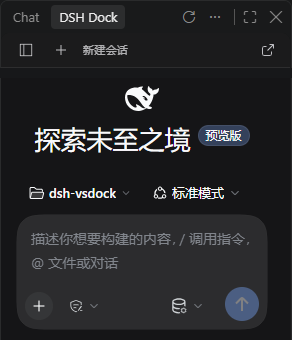

# DSH Dock for VS Code

**DeepSeek Harness's conversation in your VS Code side bar — with editor tools the agent can use.**

DSH Dock puts DSH's own conversation UI next to the code it is working on, and opens a
door back into the editor: with the plug in its title bar turned on, the agent can read
your files, selection, diagnostics and symbols from inside VS Code, and get a diff when it
changes a file. It is a client of **dsh-quickdock**, the plugin that runs inside DSH.

## Features

- **The real conversation, docked.** Tool cards, approvals, model and permission controls —
  DSH's own UI in VS Code's secondary side bar, not a re-implementation.
- **The session you are looking at.** The dock follows the session DSH bound to it and names
  it in the title bar; drag it to the primary side bar if you prefer the other side.
- **Files open where you look.** A path clicked in the docked conversation opens in this
  editor instead of the dock's own preview, resolved against your workspace folders. The
  desktop window and a browser tab keep DSH's normal behaviour.
- **Send code to the conversation.** Select code, right-click → *Add Selection to DSH Chat*;
  the composer gets `@path (lines a–b)` and the agent starts from that location.
- **Automatic review diffs.** When DSH changes or creates a file, a diff tab opens by itself:
  the old text on the left, the new file on the right, as a preview that never takes focus.
  Only the agent's own writes arrive here, so a build touching a thousand files opens
  nothing.
- **Editor tools for the agent.** Thirteen read-only tools run in VS Code — workspace
  folders, selection, diagnostics, files (unsaved buffers included), symbols, search, list
  files by pattern, definitions and references, hover, code actions, reveal, review diff.
  Five write tools (edit, save, run task, terminal, start debug) are off by default.
- **Scoped to your folders.** Tools are mounted only for sessions working inside a folder
  this window has open. When a session works elsewhere, the dock's title bar shows an amber
  warning triangle, and the list button shows what was published and what is mounted.
- **Reconnects instead of failing.** The status bar shows reachability; when nothing
  answers, the view explains the address and reason and can start DSH for you.

## How the docks fit together

DSH Dock for VS Code is one of three editor docks for the same page. **It requires DSH with
the [dsh-quickdock](https://github.com/CoplenSasbian/dsh-quickdock) plugin installed** — QuickDock
serves the conversation and the MCP bridge this extension registers its tools with.

| Project | Runs in | What it is |
|---|---|---|
| [dsh-quickdock](https://github.com/CoplenSasbian/dsh-quickdock) | DSH | The host half: serves the conversation as a loopback page and the MCP bridge the editor docks register with. **Required by every editor dock.** |
| [DSH Dock for VS Code](https://github.com/CoplenSasbian/dsh-vsdock) | VS Code | The same page in the secondary side bar, plus VS Code editor tools. |
| [DSH Dock for JetBrains IDEs](https://github.com/CoplenSasbian/dsh-intellijdock) | IntelliJ IDEA, CLion, PyCharm, WebStorm, GoLand, … | The same page in a tool window, plus JetBrains editor tools. |
| [DSH Dock for Visual Studio](https://github.com/CoplenSasbian/dsh-visualstudio) | Visual Studio 2026 | The same page in a tool window, plus Visual Studio editor tools (read-only for now). |

The editor docks can be connected to the same folder at the same time: their tool namespaces
(`vscode_*`, `mcp__<ide>__*`) do not collide.

## Requirements

- Windows 10/11 and VS Code 1.96 or newer.
- DSH (desktop or `dsh web`) with **dsh-quickdock 0.6.0+**. Older QuickDock builds show the
  dock but no editor tools; automatic diffs need the `file-events` feed from 0.6.0+.
- QuickDock's listener reachable on `http://127.0.0.1:47910` (DSH → **Settings → QuickDock →
  Connection**). A port of `0` means the listener is off.

## Install

Install the VSIX from [Releases](https://github.com/CoplenSasbian/dsh-vsdock/releases) (or
build one with `vsce package`), reload VS Code, open DSH, then press
<kbd>Ctrl</kbd>+<kbd>Alt</kbd>+<kbd>D</kbd> or click **DSH Dock** in the activity bar.

## License

MIT — see [LICENSE](LICENSE).
