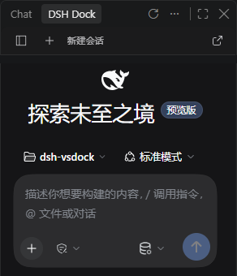

# DSH Dock for VS Code

**把 DeepSeek Harness 的对话放进 VS Code 侧边栏，并让 agent 用上你的编辑器。**

DSH Dock 把 DSH 自己的对话界面放在正在处理的代码旁边，同时打开一条反向通道：打开标题栏的
**插头**后，agent 可以在 VS Code 里读文件、选中内容、诊断和符号，改动文件时还能自动弹出
diff 供你审阅。它是 **dsh-quickdock**（运行在 DSH 里的插件）的客户端。

## 功能

- **真正的对话，就在旁边。** 工具卡片、审批、模型与权限控制都是 DSH 自己的界面，不是另外
  实现的一份，放在 VS Code 的辅助侧边栏里。
- **跟着你看的会话。** 停靠窗跟随 DSH 绑定的会话，标题栏显示会话名；也可以拖到主侧边栏。
- **文件在你看的地方打开。** 点对话里的文件路径会在**当前编辑器**打开，而不是 dock 自己的
  预览面板；桌面窗口和浏览器标签仍保持 DSH 原有行为。
- **自动审阅 diff。** DSH 修改或新建文件时自动打开 diff 标签：左边旧文本、右边新文件，预览
  模式、不抢焦点。只处理 agent 自己的写操作，旁边的构建工具改一万个文件也不会弹。
- **给 agent 的编辑器工具。** 13 个只读工具在 VS Code 里运行：工作区目录、选中内容、诊断、
  文件（含未保存缓冲区）、符号、搜索、按模式列文件、定义/引用、悬停、代码动作、定位、审阅
  diff。另有 5 个写入工具（编辑、保存、跑任务、终端、启动调试），默认关闭。
- **按目录生效。** 只有工作目录落在本窗口打开的文件夹里的会话才会挂载工具；会话在别处时，
  标题栏出现琥珀色警告三角，「列表」按钮显示发布了什么、挂载了什么。
- **断线也不空白。** 状态栏显示连通性；连不上时页面会说明尝试的地址和原因，并能直接帮你
  启动 DSH。

## 三个项目怎么配合

DSH Dock for VS Code 是同一个页面的三个编辑器 dock 之一。**它要求 DSH 安装
[dsh-quickdock](https://github.com/CoplenSasbian/dsh-quickdock) 插件**——QuickDock 负责提供
对话页面，以及本扩展注册编辑器工具的 MCP 桥。

| 项目 | 运行在 | 是什么 |
|---|---|---|
| [dsh-quickdock](https://github.com/CoplenSasbian/dsh-quickdock) | DSH | 宿主：把对话作为回环页面提供出来，并提供编辑器 dock 注册工具的 MCP 桥。**每个编辑器 dock 都依赖它。** |
| [DSH Dock for VS Code](https://github.com/CoplenSasbian/dsh-vsdock) | VS Code | 同一页面放进辅助侧边栏，外加 VS Code 编辑器工具。 |
| [DSH Dock for JetBrains IDEs](https://github.com/CoplenSasbian/dsh-intellijdock) | IntelliJ IDEA、CLion、PyCharm、WebStorm、GoLand 等 | 同一页面放进工具窗口，外加 JetBrains 编辑器工具。 |
| [DSH Dock for Visual Studio](https://github.com/CoplenSasbian/dsh-visualstudio) | Visual Studio 2026 | 同一页面放进工具窗口（编辑器工具部分还在做）。 |

这些编辑器 dock 可以同时连同一个目录：工具命名空间（`vscode_*`、`mcp__<ide>__*`）不会冲突。

## 环境要求

- Windows 10/11，VS Code 1.96 或更新。
- DSH（桌面版或 `dsh web`）安装 **dsh-quickdock 0.6.0+**。更老的 QuickDock 仍能显示页面，
  但没有编辑器工具；自动 diff 需要 0.6.0+ 提供的 `file-events`。
- QuickDock 的监听地址可达：`http://127.0.0.1:47910`（DSH → **设置 → QuickDock → 连接**）。
  端口为 `0` 表示监听已关闭。

## 安装

从 [Releases](https://github.com/CoplenSasbian/dsh-vsdock/releases) 下载 VSIX 安装（或自己用
`vsce package` 打包），重载 VS Code，打开 DSH，然后按 <kbd>Ctrl</kbd>+<kbd>Alt</kbd>+<kbd>D</kbd>
或点活动栏的 **DSH Dock**。

## 许可

MIT，见 [LICENSE](LICENSE)。
